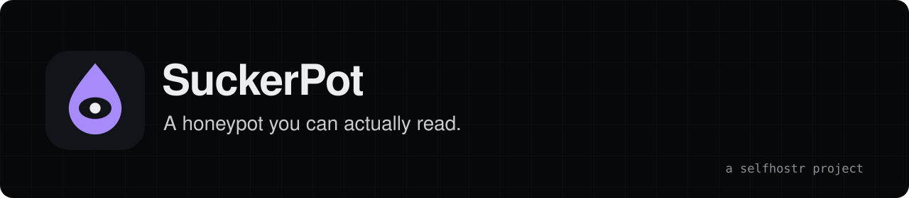

<div align="center">

<a href="https://suckerpot.selfhostr.io"></a>

<h3>A self-hosted honeypot with one dashboard that tells each attack as a short story.</h3>

[](https://github.com/selfhostr/suckerpot/actions/workflows/ci.yml)
[](https://scorecard.dev/viewer/?uri=github.com/selfhostr/suckerpot)
[](LICENSE)

</div>

Screenshots: [screenshots/](screenshots/)

## Overview

- **Twelve sensors.** Fake remote shells, web and API services, databases, and Windows and VoIP services take the attacks. Each one records what the attacker does and never runs it.
- **One readable dashboard.** Each page opens with a plain-English finding. Every IP, country, tag or URL links to a filtered view, and every filter lives in the URL.
- **Passive and opt-in.** No counter-scans, no hacking back, no automatic reporting. Sharing data with the SuckerPot network is your choice.

Free, for good. MIT licence, no paid edition.

> **SuckerPot is meant to be attacked.** Deploy it only on an isolated host or VM that you are ready to lose, and keep nothing that matters on it. Screenshots use synthetic demo data and documentation IP addresses.

## Quick start

Try the [live demo](https://suckerpot.selfhostr.io/demo/) first.

You need Docker with the compose plugin, on a machine you can afford to lose.

```bash
git clone --depth 1 --branch v0.9.0 https://github.com/selfhostr/suckerpot.git
cd suckerpot
./scripts/install.sh
```

The installer creates the secrets, starts the stack and prints the address of the dashboard. Open it and follow the setup checklist. The six recommended sensors are on by default; `--sensors all` turns on all twelve.

Before you expose anything, follow the [go-live checklist](https://suckerpot.selfhostr.io/docs/deployment/) and apply [scripts/host/firewall.nft](scripts/host/firewall.nft). Keep the dashboard port filtered upstream. Back up with `just backup`.

Only want to help the SuckerPot network? `./scripts/install.sh --participant` installs sensors without a dashboard. See [Join the network](https://suckerpot.selfhostr.io/docs/participate/).

## Features

- **Sensors** for SSH, Telnet, ADB, Web, Docker, Synology, Redis, MySQL, MSSQL, RDP, SMB and SIP.
- **Enrichment and tags**: GeoIP and ASN, optional reputation lookups, and a YAML rules engine.
- **Campaigns, MITRE ATT&CK techniques and a script library**, each with a plain-English story.
- **Defend**: scored blocklists, OPNsense and pfSense exports, Sigma and Suricata rules.
- **Alerts and a weekly report** by Discord, Microsoft Teams and e-mail. Every rule is off until you switch it on.
- **Anonymous abuse-report drafts**, with an identity check before anything leaves.
- **Hardened by default**: non-root, read-only containers, isolated networks, one Redis ACL user per sensor.

Details and screenshots: [What SuckerPot does](docs/features.md).

## Architecture

Sensors feed Redis Streams, ingest enriches and stores the events in PostgreSQL with TimescaleDB, and a FastAPI service serves the React dashboard. Sensors are the only services published to the internet and can reach Redis and nothing else. See [Architecture](docs/ARCHITECTURE.md).

## Limits

- It is a honeypot: it will be scanned and attacked within minutes of going online.
- Sensors imitate services. A patient attacker can tell they are fake.
- Analysis features such as campaigns, scripts and blocklists are off until you enable them, with an `*_ENABLED` variable each.
- The web and Synology sensors are still under security review.
- Delivery from sensors to the database is at least once, so a crash can count a batch twice.

See [Security](docs/SECURITY.md) for the threat model.

## Status

Alpha, version `v0.9.0`. Before 1.0 the API, the database schema and the installer can change between minor versions. The [changelog](CHANGELOG.md) lists every change and how to upgrade.

## Contributing

Bug reports, new sensors and translations are welcome. Everything runs in containers: see [CONTRIBUTING.md](CONTRIBUTING.md) and the [development guide](docs/development.md). Security issues: [SECURITY.md](SECURITY.md).

## License

MIT, see [LICENSE](LICENSE). SuckerPot is provided "as is", without warranty of any kind. You run it at your own risk.

## Support SuckerPot

SuckerPot is free and has no company behind it. If it saves you time, you can support its development:

- **GitHub Sponsors** (recurring or one-off): [github.com/sponsors/selfhostr](https://github.com/sponsors/selfhostr)
