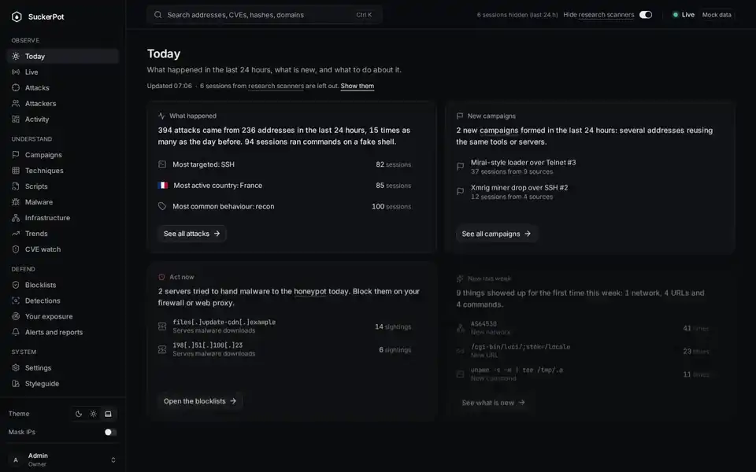
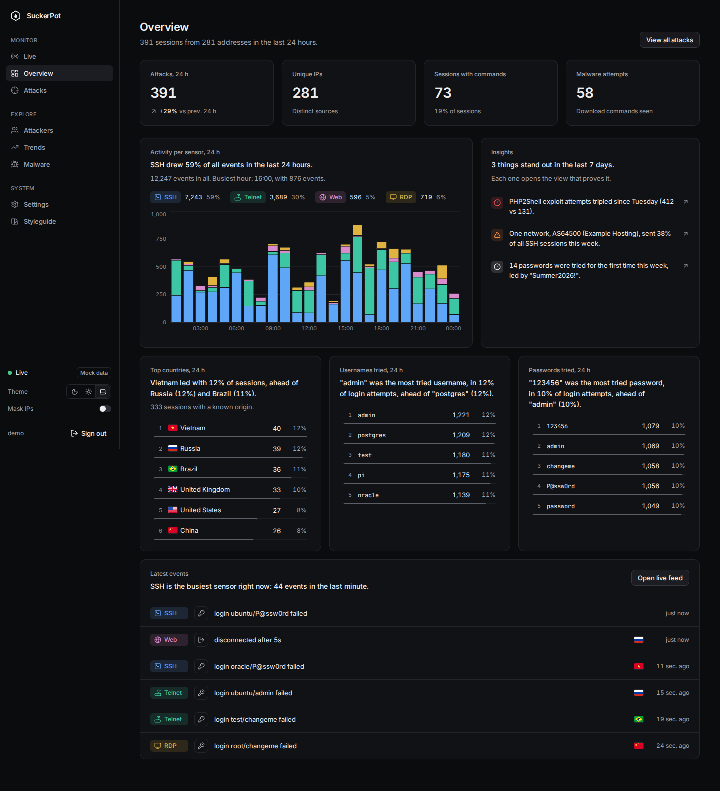
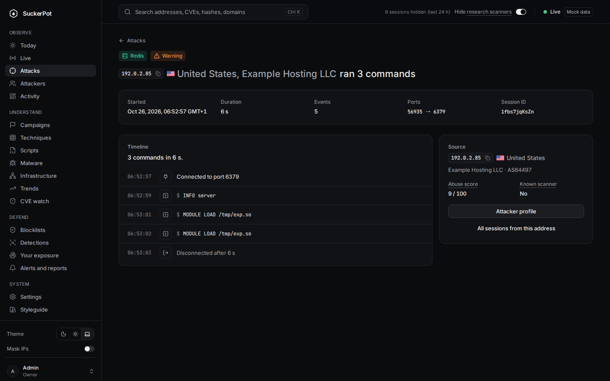
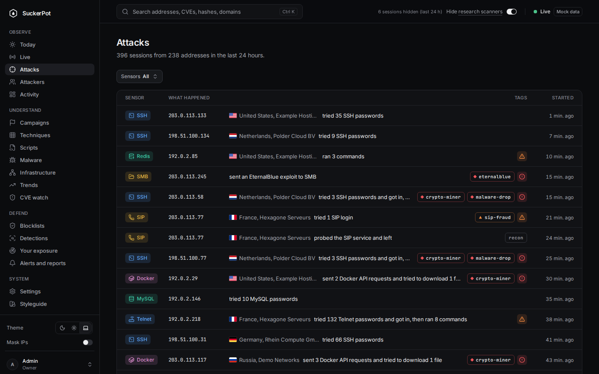
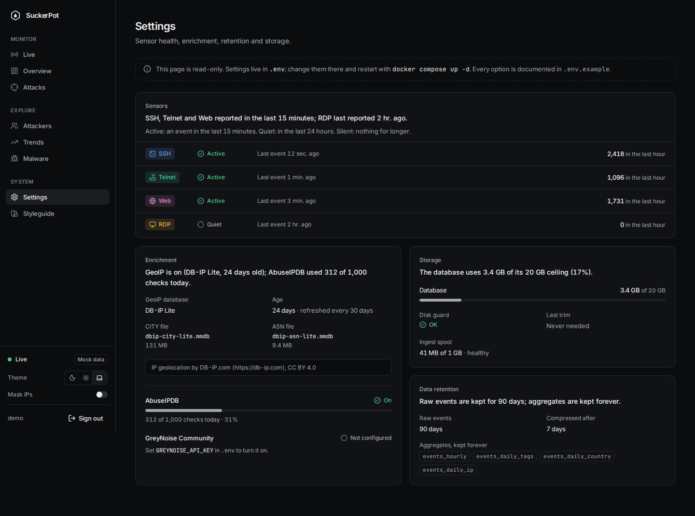
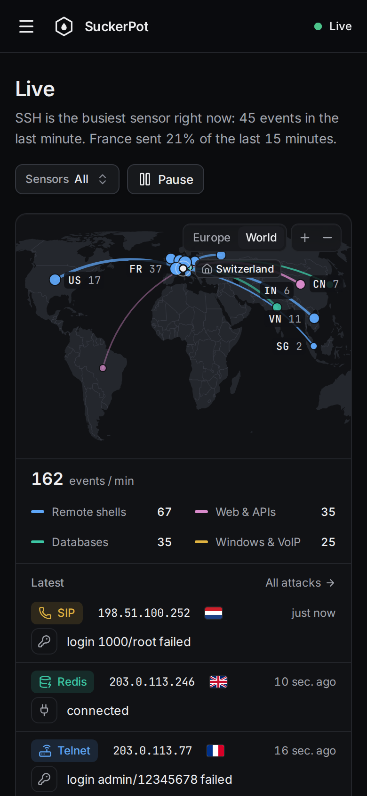
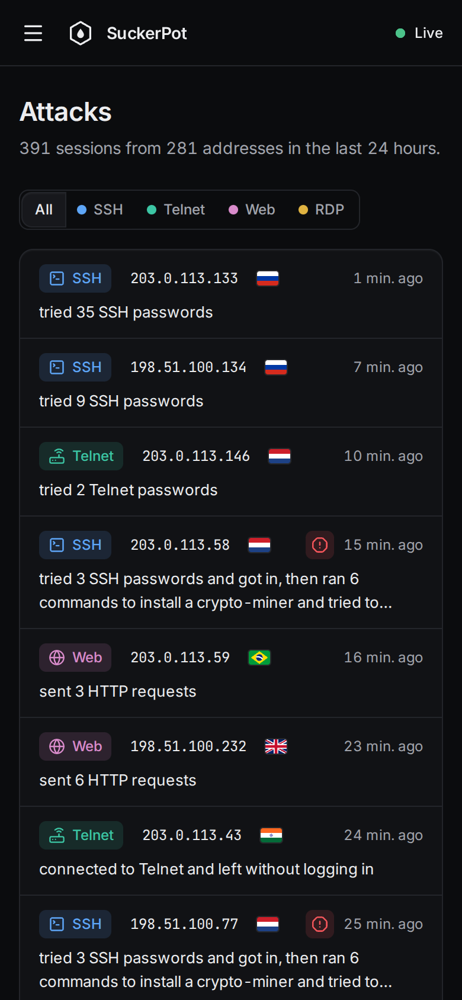
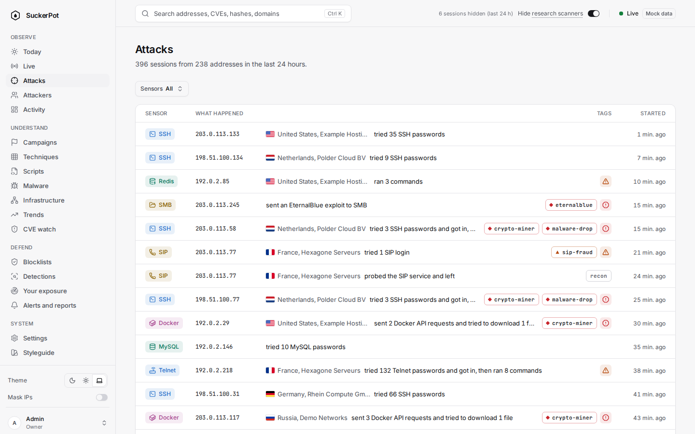

<div align="center">

# SuckerPot

**A self-hosted honeypot with one readable dashboard: a few realistic sensors for SSH, Telnet, web and RDP, and a UI that tells each attack as a short story you can click through.**

[Documentation](https://suckerpot.readthedocs.io) · [Releases](https://github.com/Theroxat/suckerpot/releases) · [Changelog](CHANGELOG.md)

[](https://github.com/Theroxat/suckerpot/actions/workflows/ci.yml)
[](https://suckerpot.readthedocs.io)


[](docker-compose.yml)
[](LICENSE)

</div>



> **SuckerPot is meant to be attacked.** Deploy it only on an isolated host or VM that you are ready to lose, and keep nothing that matters on it. It is purely passive: no counter-scans, no hacking back, no automatic reporting. Attacker input is never executed. All screenshots use synthetic demo data and documentation IP addresses.

## Why

Most honeypot stacks are a pile of separate tools and dashboards that are hard to read. SuckerPot goes the other way: few sensors, built well, and ONE dashboard that is the product. Each page opens with a plain-English finding, every IP, country, tag or URL is a link to a filtered view, and every filter lives in the URL so you can share it.

## Status

`v0.1.0` is released. All four sensors, enrichment, tagging, the dashboard, login, retention and backups are built. Every sensor went through several rounds of adversarial security review; all passed. See the [roadmap](docs/ROADMAP.md).

## Features

- **SSH sensor.** The fingerprint of OpenSSH 9.6 on Ubuntu, a configurable set of weak logins, and a pure-emulation shell over an in-memory fake filesystem. It records every login attempt and command, records `wget` / `curl` / `tftp` downloads as URLs only, and keeps timed terminal I/O for replay (see [the sensor notes](sensors/ssh/README.md)).
- **Telnet sensor.** A BusyBox telnetd look-alike with Mirai-style login and command flows.
- **Web sensor** (in final security review). A byte-identical fake Apache 2.4.58 with PHP 8.3 (unpatched mod_php), WordPress and phpMyAdmin pages, and detection of PHP2Shell (upload-progress) exploit attempts, tagged `php2shell`.
- **RDP sensor.** A Windows Server look-alike with NLA that captures usernames.
- **Enrichment and tags.** GeoIP and ASN from DB-IP Lite (no key needed) or MaxMind GeoLite2, optional AbuseIPDB and GreyNoise Community reputation with a 24 h cache and enforced daily quotas, and a declarative YAML rules engine (no regular expressions) for tags such as `recon`, `mirai`, `crypto-miner`, `malware-drop` and `php2shell`.
- **Dashboard.** Live (3D globe and event feed), Overview (KPIs and auto-written insights), Attacks, Session detail with a terminal replay at real speed, Attackers (by IP and by ASN), Trends, Malware (defanged URLs) and Settings (sensor health, quotas, retention, storage). Dark and light, desktop and mobile. A single admin login (argon2, CSRF protection) guards it, and a screenshot mode (`?mask=1`) masks addresses.
- **Retention and backups.** Raw events kept 90 days, aggregates forever, compression after 7 days, a disk guard, and `just backup` / `just restore`.
- **Hardened by default.** Non-root, read-only containers with all capabilities dropped and `no-new-privileges`; isolated networks with an internal backend; one Redis ACL user per sensor, limited to `XADD` on its own stream; least-privilege database roles; no outbound route for the API; and an nftables [host firewall template](scripts/host/firewall.nft).

<p>
  
  
</p>
<p>
  
  
</p>
<p>
  
  
  
</p>

## Architecture

```
Internet --> sensors (ssh, telnet, web, rdp) --> Redis Streams --> ingest --> PostgreSQL + TimescaleDB --> API (FastAPI) --> Web UI (React)
             network "sensors"                   (ACL per sensor)  (only service with outbound access)   network "backend" (internal)   also serves the built UI
```

Sensors are the only services published to the internet, and they can reach Redis and nothing else. Details, networks and the shared event schema are in [docs/ARCHITECTURE.md](docs/ARCHITECTURE.md) and [docs/event-schema.md](docs/event-schema.md).

## Quick start (Docker Compose)

You need Docker with the compose plugin, on a machine you can afford to lose.

```bash
git clone https://github.com/Theroxat/suckerpot.git
cd suckerpot
cp .env.example .env        # replace every change-me with a value from: openssl rand -base64 32
docker compose up -d --build --wait
docker compose --profile tools run --rm demo     # or: just demo
```

Open http://127.0.0.1:8443. The dashboard binds to loopback by default (`DASHBOARD_BIND`).

**Before you expose anything**, follow the go-live checklist in [docs/deployment.md](docs/deployment.md) and apply [scripts/host/firewall.nft](scripts/host/firewall.nft). Set the admin password hash in `.env` (see [docs/deployment.md](docs/deployment.md)) and keep the dashboard port filtered upstream.

## Configuration

Everything is set through environment variables in `.env`. The most important ones:

| Variable | Default | Purpose |
| --- | --- | --- |
| `DASHBOARD_BIND` | `127.0.0.1` | Address the dashboard is published on. |
| `DASHBOARD_PORT` | `8443` | Dashboard port (never a sensor port). |
| `SSH_HOST_PORT` | `22` | Host port mapped to the SSH sensor (container port 2222). |
| `SSH_ACCEPT_CREDENTIALS` | a few weak pairs | Logins the SSH sensor lets through. |
| `SSH_MAX_PER_IP` | `5` | Concurrent SSH connections per source IP. |
| `FETCH_PAYLOADS` | `false` | Let ingest fetch payloads into quarantine (off by default). |
| `RETENTION_DAYS` | `90` | How long raw events are kept. |
| `DEMO_SESSIONS` | `3000` | Sessions created by the demo generator. |

The full list is in [`.env.example`](.env.example) and [docs/configuration.md](docs/configuration.md).

## Development

Everything runs in containers; the host only needs Docker and [`just`](https://github.com/casey/just).

```bash
just up          # build and start the stack, wait until healthy
just demo        # fill it with synthetic attacks
just check       # lint, typecheck, tests and web build
just --list      # every recipe
```

Install the gitleaks pre-commit hook once with `scripts/install-hooks.sh`. See [CONTRIBUTING.md](CONTRIBUTING.md) and [docs/development.md](docs/development.md).

## Security

SuckerPot runs hostile traffic through containers, so isolation is a feature, not an afterthought. The design and the threat model are in [docs/SECURITY.md](docs/SECURITY.md). To report a vulnerability, read [SECURITY.md](SECURITY.md) and use GitHub's private reporting.

## Roadmap

| Milestone | Scope | State |
| --- | --- | --- |
| M0 | Bootstrap, docs, CI, secret scanning | Done |
| M1 | Compose stack, event pipeline, API, demo data | Done |
| M2 | SSH sensor | Done |
| M3 | Design system and web shell | Done |
| M4 | Enrichment and tagging | Done |
| M5 | Core pages and terminal replay | Done |
| M6 | Telnet, web and RDP sensors | Done |
| M7 | Live globe, Trends, Malware | Done |
| M8 | Dashboard login, retention, backups, `v0.1.0` | Done (`v0.1.0`) |

Details in [docs/ROADMAP.md](docs/ROADMAP.md).

## License

[MIT](LICENSE).
