<div align="center">

# SuckerPot

**A self-hosted honeypot with one readable dashboard: twelve realistic sensors for remote shells, web and APIs, databases, and Windows and VoIP services, and a UI that tells each attack as a short story you can click through.**

[Website](https://suckerpot.selfhostr.io/) · [Live demo](https://suckerpot.selfhostr.io/demo/) · [Documentation](https://suckerpot.selfhostr.io/docs/) · [Releases](https://github.com/selfhostr/suckerpot/releases) · [Changelog](CHANGELOG.md)

[](https://github.com/selfhostr/suckerpot/actions/workflows/ci.yml)
[](https://suckerpot.selfhostr.io/docs/)


[](docker-compose.yml)
[](LICENSE)

</div>

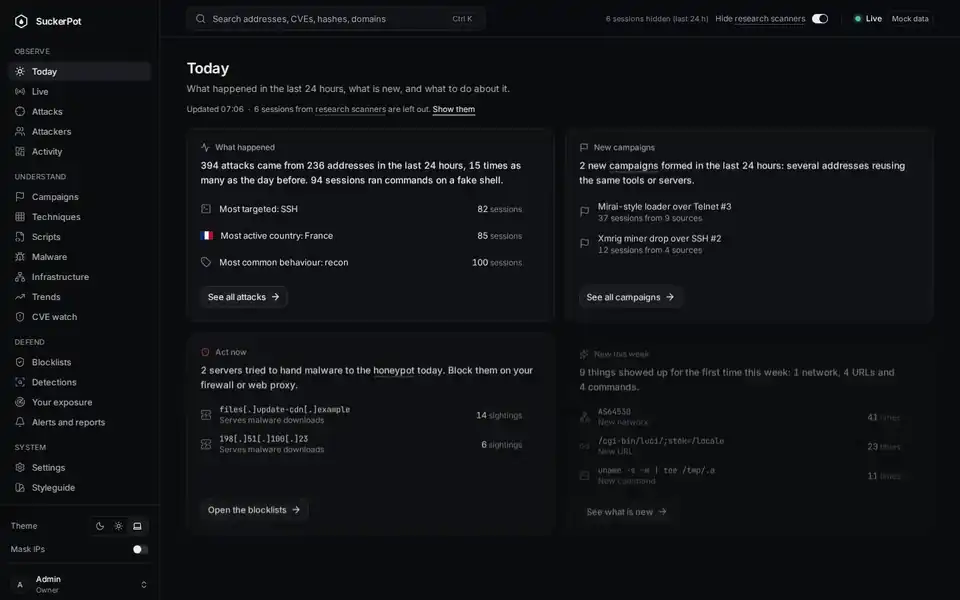

> **SuckerPot is meant to be attacked.** Deploy it only on an isolated host or VM that you are ready to lose, and keep nothing that matters on it. It is purely passive: no counter-scans, no hacking back, no automatic reporting. Attacker input is never executed. All screenshots use synthetic demo data and documentation IP addresses.

> SuckerPot is made by [Selfhostr](https://selfhostr.io), a small organisation that builds self-hosted tools. Technical names (packages, volumes, environment variables) use the `suckerpot` prefix.
>
> The documentation is at <https://suckerpot.selfhostr.io/docs/>. The same pages are in the [`docs/`](docs/) folder of this repository, so you can read them on GitHub too.

## Why

Most honeypot stacks are a pile of separate tools and dashboards that are hard to read. SuckerPot goes the other way: few sensors, built well, and ONE dashboard that is the product. Each page opens with a plain-English finding, every IP, country, tag or URL is a link to a filtered view, and every filter lives in the URL so you can share it.

## Status

The current release is `v0.9.0`: participant installs check that the internet reaches the sensors and offer a host firewall, every internal network is isolated from the host, and automatic updates can no longer be rushed by a release. `v0.8.0` moved the project to the Selfhostr organisation (`github.com/selfhostr/suckerpot`, images at `ghcr.io/selfhostr`), with new hub and feed addresses and the docs and demo at [suckerpot.selfhostr.io](https://suckerpot.selfhostr.io/). Installs on `v0.7.1` or earlier need [one manual step](docs/updates.md#moving-from-the-old-repository-v071-and-earlier) for this update. `v0.7.0` turned the SuckerPot network on by default, with one-button join and leave. Earlier, `v0.6.0` added the SuckerPot network, a public community blocklist, a three-command participant install, a one-command installer and signed automatic updates. Earlier releases brought twelve sensors, the dashboard, campaigns, ATT&CK, Defend, scripts, alerts, the weekly report and anonymous reporting. The new analysis features are off until you turn them on, with an `*_ENABLED` variable each (see [configuration](docs/configuration.md)). Every sensor and feature goes through adversarial security review before it is accepted. See the [changelog](CHANGELOG.md) and the [roadmap](docs/ROADMAP.md).

## Features

- **SSH sensor.** The fingerprint of OpenSSH 9.6 on Ubuntu, a configurable set of weak logins, and a pure-emulation shell over an in-memory fake filesystem. It records every login attempt and command, records `wget` / `curl` / `tftp` downloads as URLs only, and keeps timed terminal I/O for replay (see [the sensor notes](sensors/ssh/README.md)).
- **Telnet sensor.** A BusyBox telnetd look-alike with Mirai-style login and command flows.
- **Web sensor.** A byte-identical fake Apache 2.4.58 with PHP 8.3 (unpatched mod_php), WordPress and phpMyAdmin pages, and detection of PHP2Shell (upload-progress) exploit attempts, tagged `php2shell`.
- **RDP sensor.** A Windows Server look-alike with NLA. It records NTLM logins, checks decoy passwords, identifies the client tool, and can optionally capture cleartext passwords from clients that skip NLA (owner opt-in).
- **Twelve sensors in four families.** Each family has its own colour in the dashboard, and each sensor has its own icon and name.

| Family | Sensors | What they fake |
| --- | --- | --- |
| Remote shells | SSH, Telnet, ADB | An OpenSSH 9.6 server, a BusyBox login, an Android TV box with `adbd` and no authentication |
| Web and APIs | Web, Docker, Synology | Apache 2.4 with unpatched PHP 8.3, WordPress and phpMyAdmin; an exposed Docker Engine API; a Synology NAS with unpatched DSM 7.2.1 (login page and Web API) |
| Databases | Redis, MySQL, MSSQL | Redis 7.2 with no password; MySQL 8.0 and SQL Server with weak logins |
| Windows and VoIP | RDP, SMB, SIP | A Windows Server with NLA; a Windows file service (observation only); an Asterisk-style PBX on UDP and TCP |

Each sensor records what the attacker does and never runs it. SIP answers are capped so that the sensor cannot be used to amplify a flood.
- **Enrichment and tags.** GeoIP and ASN from DB-IP Lite (no key needed) or MaxMind GeoLite2, optional AbuseIPDB and GreyNoise Community reputation with a 24 h cache and enforced daily quotas, and every key is optional (see [Provider API keys](docs/api-keys.md)), and a declarative YAML rules engine (no regular expressions) for tags such as `recon`, `mirai`, `crypto-miner`, `malware-drop` and `php2shell`.
- **Dashboard.** Pages are grouped in three spaces plus Settings, so you always know where you are:
  - **Observe:** Today, Live (a flat world map of the last 15 minutes), Attacks, Attackers (by IP and by ASN) and Activity.
  - **Understand:** Campaigns, Techniques, Scripts, Malware, Infrastructure, Trends and CVE watch.
  - **Defend:** Blocklists, Detections, Your exposure, Abuse reports, and Alerts and reports.
  - **System:** Settings (sensor health, API keys, quotas, retention, storage, users).

  A session page has a terminal replay at real speed. `Ctrl+K` opens a search box that finds an IP, hash, domain, CVE or campaign. Security words have a glossary tooltip. Known research scanners are hidden by default. Dark and light, desktop and mobile. An owner login plus optional administrator and read-only viewer accounts (argon2, CSRF protection, lockout, audit log) guard it, and a screenshot mode (`?mask=1`) masks addresses.
- **Campaigns.** Sessions that share a script, a payload host, a file hash, a malware family, an exploit or a credential list are grouped into one campaign, with a plain-English story. A campaign needs at least two sources, and research scanners are never grouped.
- **Techniques.** Each session is labelled with the MITRE ATT&CK techniques it used. The Techniques page shows them as a heatmap per day.
- **Scripts.** The command sequences that attackers type are fingerprinted into a library. Each script has a plain-English explanation from a rules base. An optional LLM explainer is off by default, and when on it sees only the normalised script text.
- **Anonymous reporting.** Drafts of abuse reports for the networks that host attackers, found through RDAP behind the VPN, plus STIX 2.1 and MISP exports and password-protected sample bundles. An identity check blocks any report that could point back to you, and the wording around the facts is yours and optional. Each report is reviewed first, then sent by hand or through the VPN.
- **Defend.** Scored blocklists with a reason for every point, exports for OPNsense and pfSense aliases, an opt-in token feed for firewalls, Sigma and Suricata rules marked "review before deploying", and "Your exposure", which compares your own service inventory with what was recorded.
- **Alerts and reports.** Discord, Microsoft Teams and e-mail alerts for new campaigns, new download hosts, malware drops and watched CVEs. Every rule is off until you switch it on. A weekly report has a one-page printable view.
- **Today and search.** A Today home page says what changed in the last 24 hours. One search box finds an IP, hash, domain, CVE or campaign. Known research scanners are labelled, and hidden from lists unless you ask for them. A glossary explains the terms.
- **Opt-in network and public blocklist.** Many SuckerPot systems can share aggregate attacker data, and the network confirms a target only when several independent sensors agree. Joining is a choice you make in the installer or the dashboard. A community blocklist built from it is published for free, once the network has confirmed its first targets. See [the network](docs/network.md) and [the public feeds](docs/feeds.md).
- **Retention and backups.** Raw events kept 90 days, aggregates forever, compression after 7 days, a disk guard, and `just backup` / `just restore`.
- **Hardened by default.** Non-root, read-only containers with all capabilities dropped and `no-new-privileges`; isolated networks with an internal backend; one Redis ACL user per sensor, limited to `XADD` on its own stream; least-privilege database roles; no outbound route for the API; and an nftables [host firewall template](scripts/host/firewall.nft).

<p>
  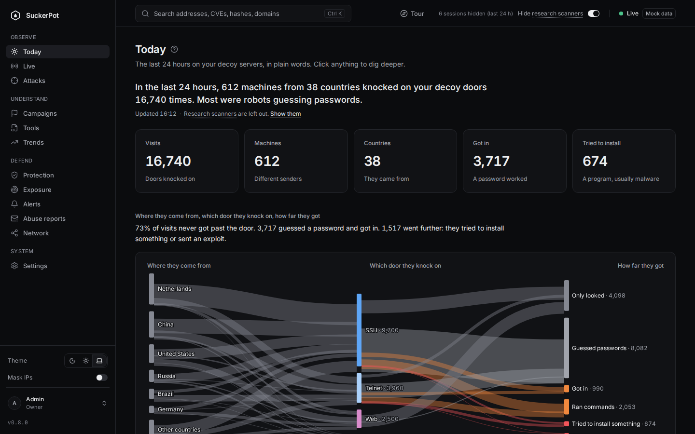
  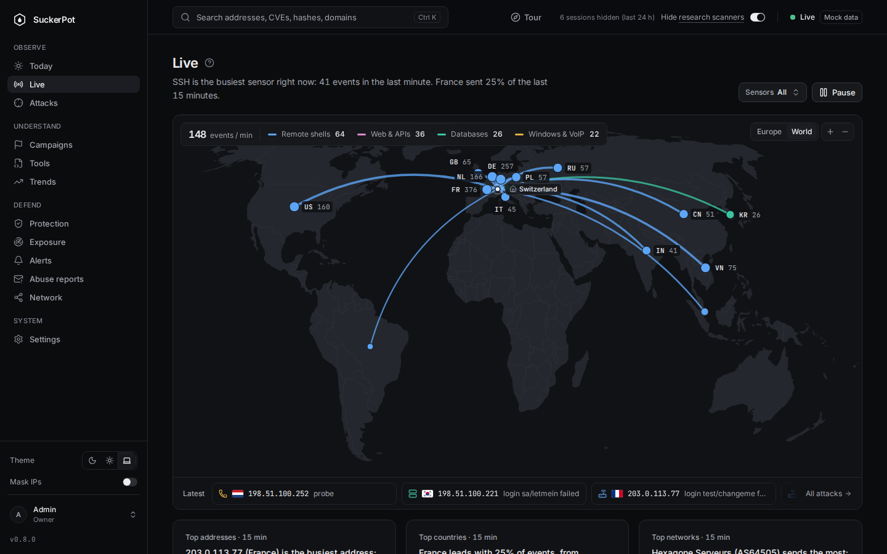
</p>
<p>
  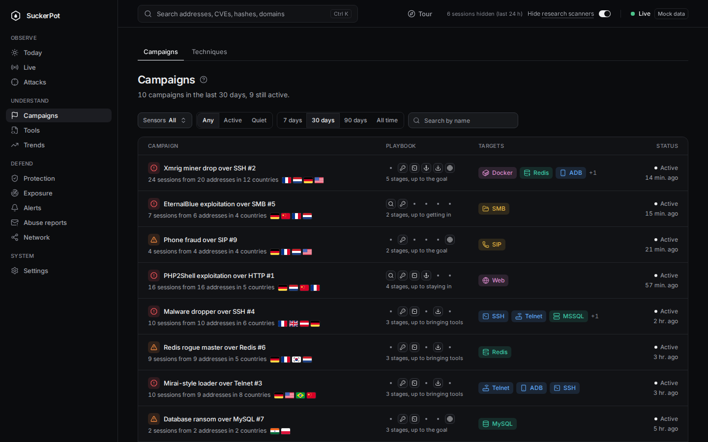
  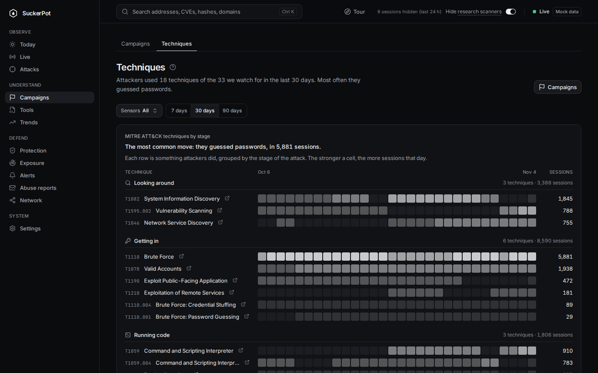
</p>
<p>
  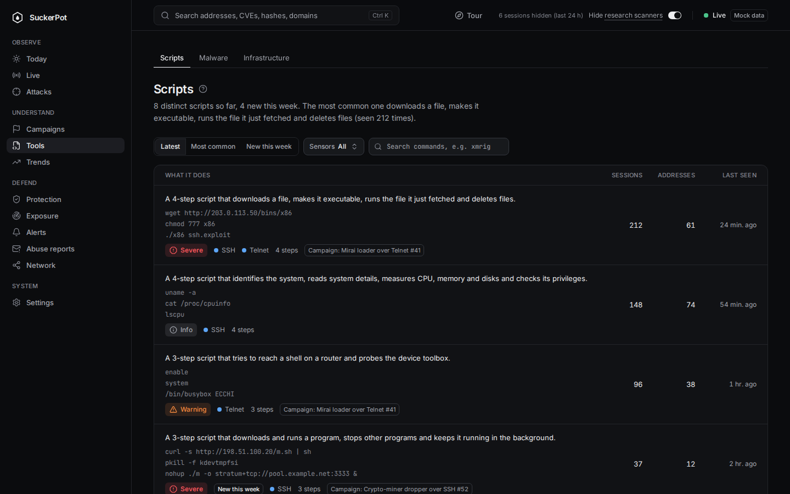
  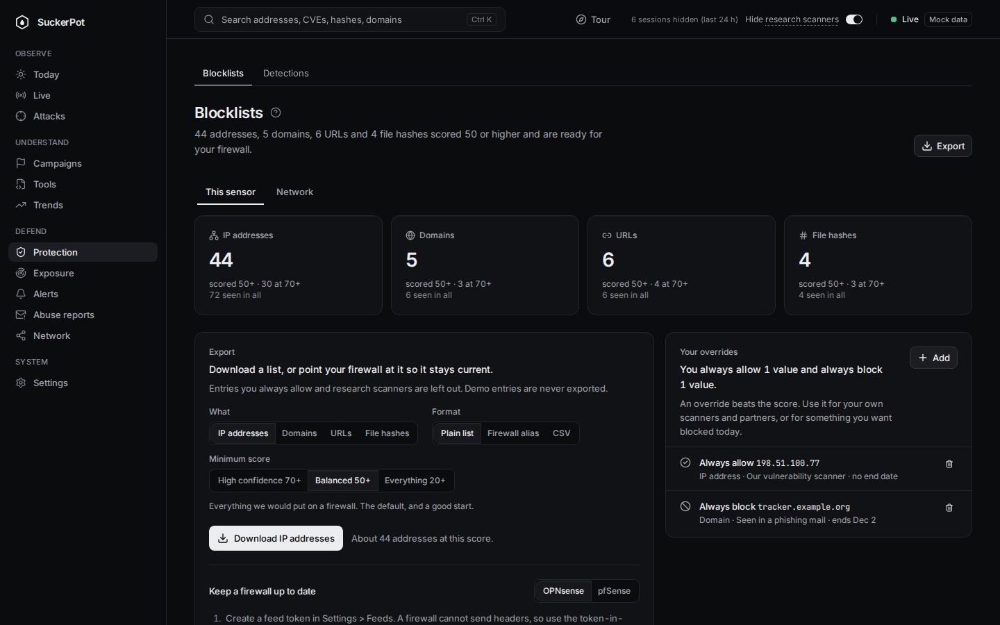
</p>
<p>
  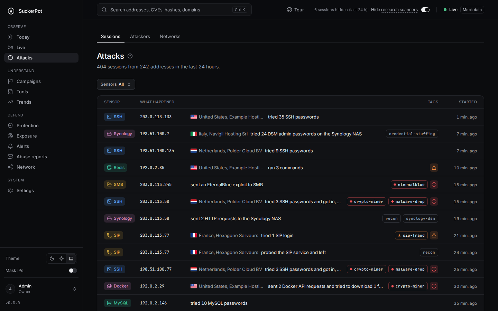
  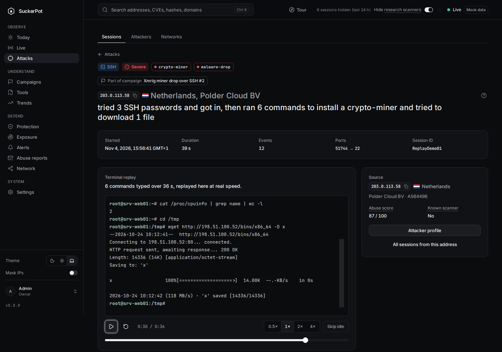
</p>
<p>
  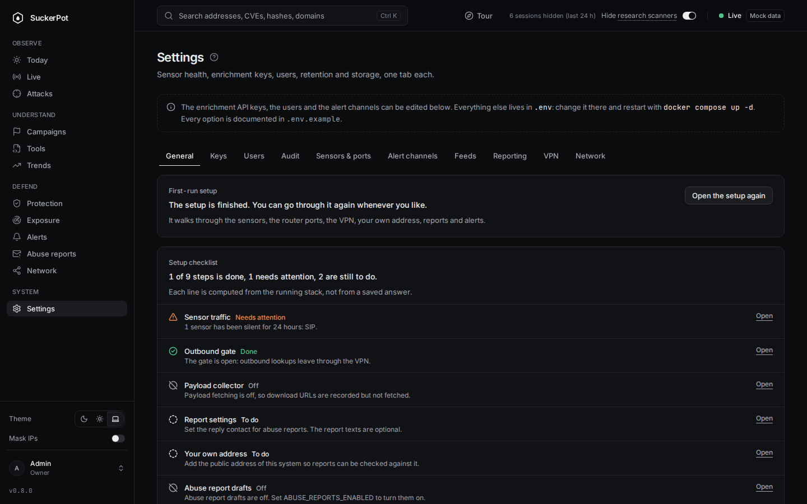
  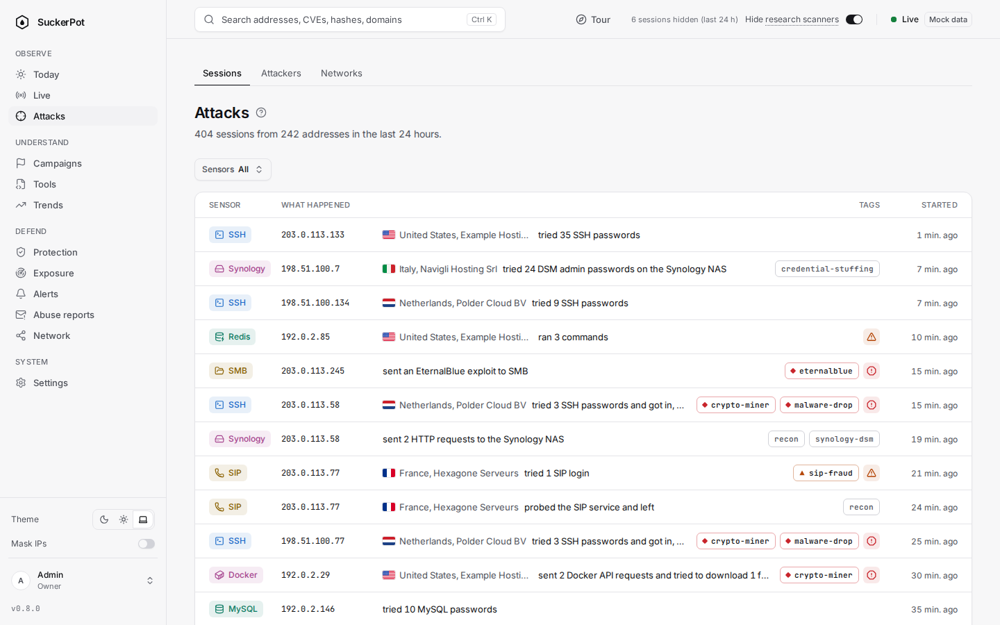
</p>
<p>
  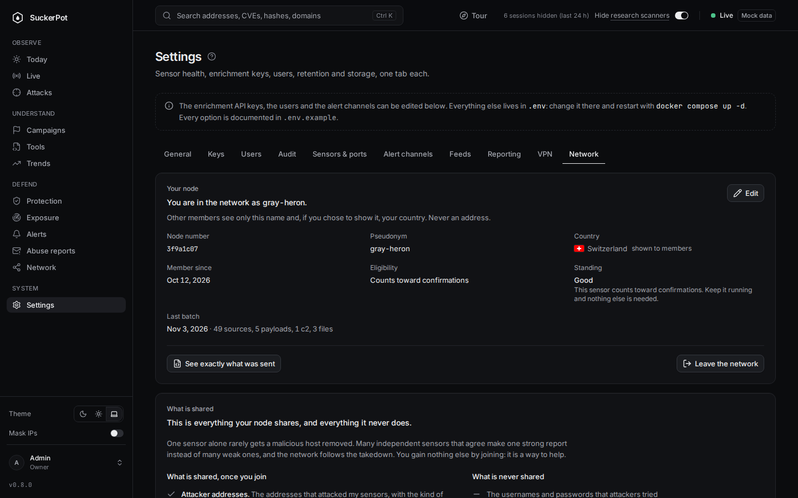
  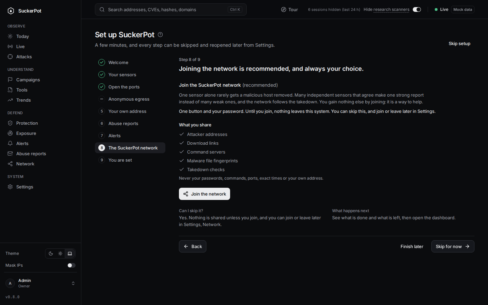
</p>
<p>
  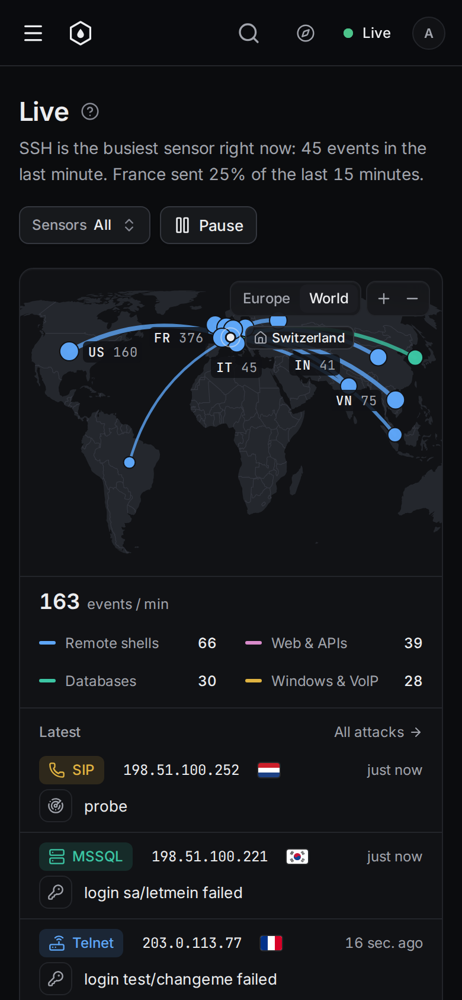
  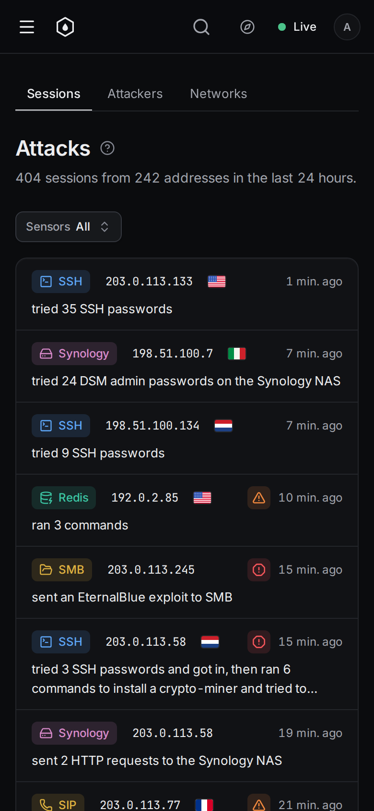
</p>

## Architecture

```
Internet --> sensors (twelve, one stream each) --> Redis Streams --> ingest --> PostgreSQL + TimescaleDB --> API (FastAPI) --> Web UI (React)
             network "sensors"                   (ACL per sensor)  (no route out; lookups go via the VPN)   network "backend" (internal)   also serves the built UI
```

Sensors are the only services published to the internet, and they can reach Redis and nothing else. Details, networks and the shared event schema are in [docs/ARCHITECTURE.md](docs/ARCHITECTURE.md) and [docs/event-schema.md](docs/event-schema.md).

## Quick start

You need Docker with the compose plugin, on a machine you can afford to lose.

```bash
git clone --depth 1 --branch v0.9.0 https://github.com/selfhostr/suckerpot.git
cd suckerpot
./scripts/install.sh
```

The installer creates the secrets, starts the stack and prints the address of the dashboard. Open it and follow the setup checklist. By default the six recommended sensors are on; `--sensors all` turns on all twelve. For the steps by hand, see [Manual setup](docs/getting-started.md#manual-setup).

**Before you expose anything**, follow the go-live checklist in [docs/deployment.md](docs/deployment.md) and apply [scripts/host/firewall.nft](scripts/host/firewall.nft). Keep the dashboard port filtered upstream. Set `INDICATORS_IGNORE` in `.env` to your public IP and host names, so they are never recorded as attack infrastructure.

## Join the SuckerPot network

Want to help the SuckerPot network and nothing else? Three commands, no dashboard, no VPN needed:

```bash
git clone --depth 1 --branch v0.9.0 https://github.com/selfhostr/suckerpot.git
cd suckerpot
./scripts/install.sh --participant
```

Then open the ports the installer prints. Choosing this mode is your consent to join. Without a VPN, the hub (and the tunnel provider in front of it) sees your home address; the hub never stores it, and you can add a VPN later with `./scripts/participant.sh vpn <file>`. Signed releases install themselves once a day, at least 48 hours after they are published; turn that off with `./scripts/participant.sh auto-update off`. Check the state with `./scripts/status.sh`. Details: [docs/participate.md](docs/participate.md).

## Configuration

Everything is set through environment variables in `.env`. The most important ones:

| Variable | Default | Purpose |
| --- | --- | --- |
| `DASHBOARD_BIND` | `127.0.0.1` | Address the dashboard is published on. |
| `DASHBOARD_PORT` | `8443` | Dashboard port (never a sensor port). |
| `SSH_HOST_PORT` | `22` | Host port mapped to the SSH sensor (container port 2222). |
| `SSH_ACCEPT_CREDENTIALS` | a few weak pairs | Logins the SSH sensor lets through. |
| `SSH_MAX_PER_IP` | `5` | Concurrent SSH connections per source IP. |
| `COLLECTOR_ENABLED` | `false` | Fetch captured download URLs through the VPN into quarantine and analyse them (off by default). Needs `COMPOSE_PROFILES=egress`. |
| `RETENTION_DAYS` | `90` | How long raw events are kept. |
| `DEMO_SESSIONS` | `3000` | Sessions created by the demo generator. |

The full list is in [`.env.example`](.env.example) and [docs/configuration.md](docs/configuration.md).

## Development

Everything runs in containers; the host only needs Docker and [`just`](https://github.com/casey/just).

```bash
just up          # build and start the stack, wait until healthy
just demo        # fill it with synthetic attacks
just check       # lint, typecheck, tests and web build
just --list      # every recipe
```

Install the gitleaks pre-commit hook once with `scripts/install-hooks.sh`. See [CONTRIBUTING.md](CONTRIBUTING.md) and [docs/development.md](docs/development.md).

## Security

SuckerPot runs hostile traffic through containers, so isolation is a feature, not an afterthought. The design and the threat model are in [docs/SECURITY.md](docs/SECURITY.md). To report a vulnerability, read [SECURITY.md](SECURITY.md) and use GitHub's private reporting.

## Roadmap

Shipped through `v0.9.0`. See [docs/ROADMAP.md](docs/ROADMAP.md) for every milestone.

## License

[MIT](LICENSE).

## Support SuckerPot

SuckerPot is free and has no company behind it. If it saves you time, you can support its development:

- **Patreon** (recurring): [patreon.com/selfhostr](https://www.patreon.com/selfhostr)
- **Bitcoin**: `bc1phcqfc46ev9ztpuxyh3fmz6aaktshnz8z4ve9jk7pxdcyu9ks37wqq2kjgd`
- **Ethereum**: `0x67Cd93028943308B8c12782C9ad078D253278f40`
- **Solana**: `63u8bhkf63HBcNYbRRyaHPtfRtSUmbugtwaauzAxHtb3`
